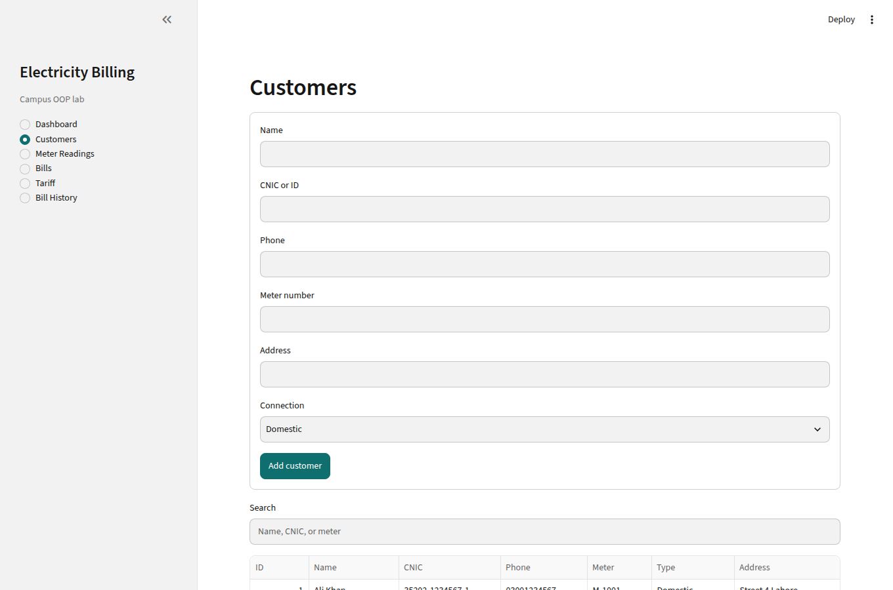
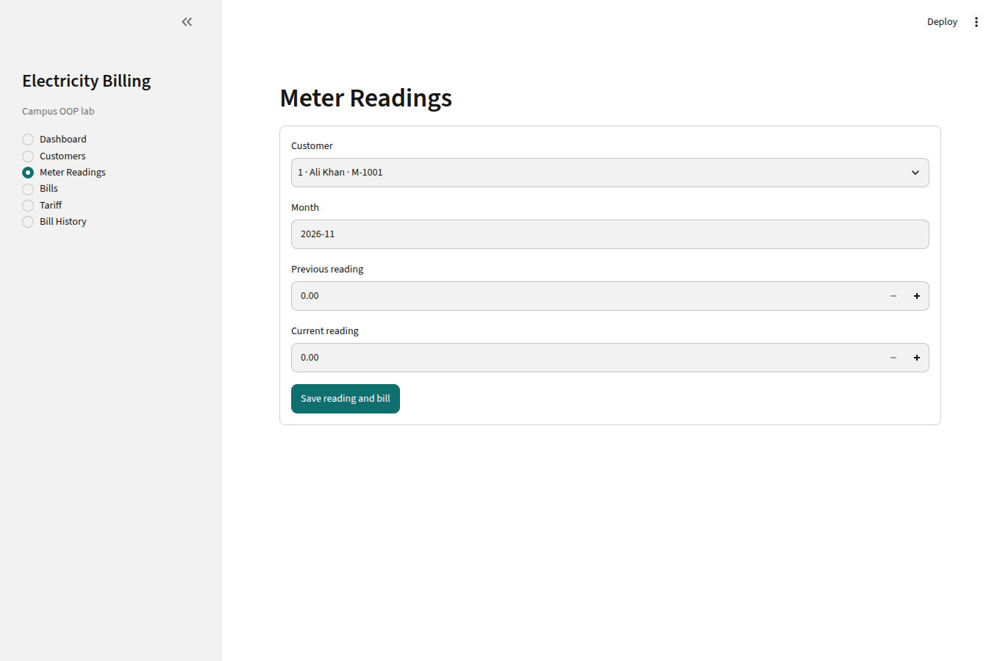
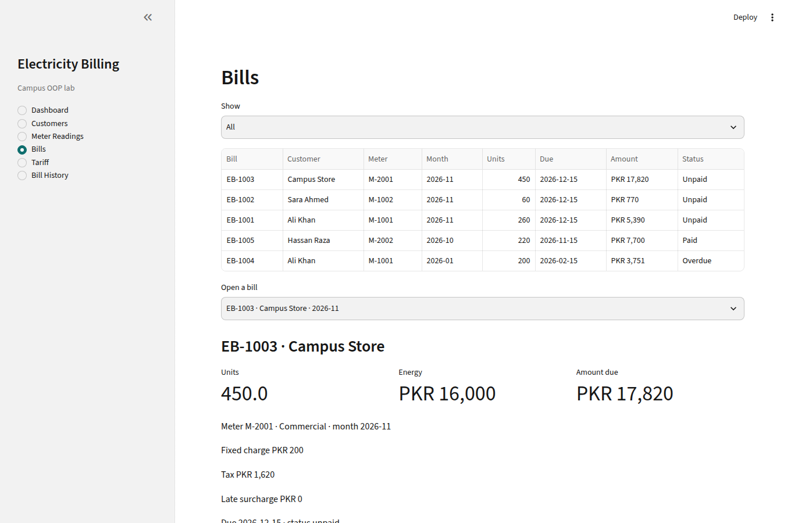
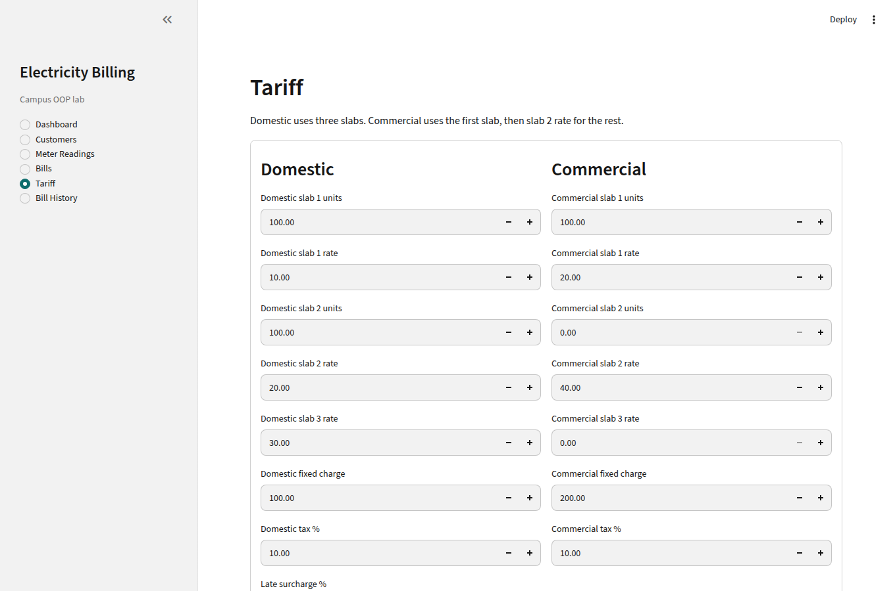
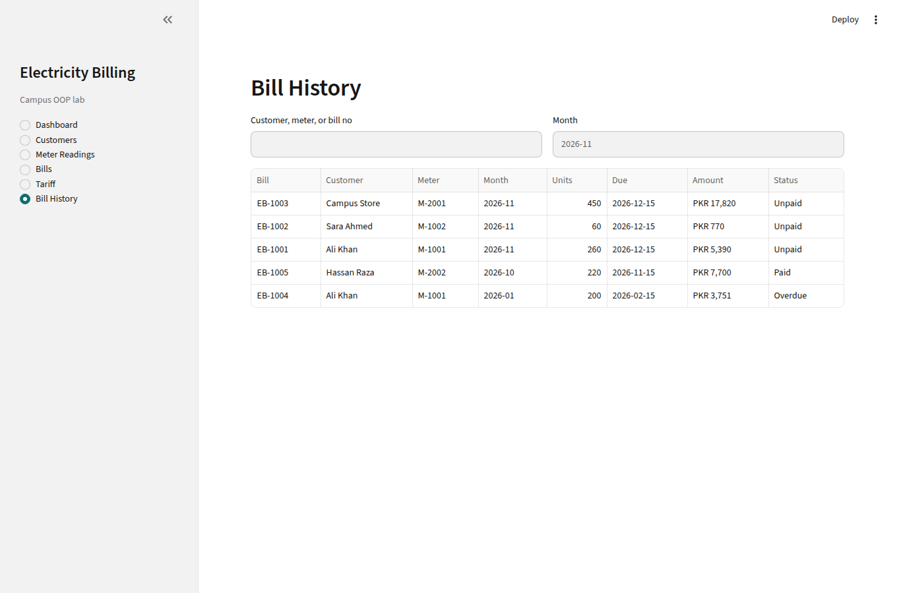

# Electricity Billing

This is our 3rd semester OOP project. It keeps customers, meter readings, and monthly bills for a small electricity office. The screen is Streamlit. The records sit in a SQLite file, `data/billing.db`, so they stay after a refresh on your own computer.

## How to run

```bash
python3 -m venv .venv
source .venv/bin/activate
pip install -r requirements.txt
streamlit run app.py
```

Tests:

```bash
python3 -m pytest tests -v
```

The last run here was **13 passed in 0.88s**. The full list is in `docs/PROJECT_REPORT.md`.

## What you can do

- Add, search, update, and delete customers. Each one has a name, CNIC or ID, address, phone, meter number, and a connection type (Domestic or Commercial).
- Enter a previous and current reading for a month. The current reading cannot be lower than the previous one, and the same month cannot be saved twice for one meter.
- A bill is made with the reading. The energy charge uses slabs. Domestic and commercial use different slabs. A fixed charge and a tax percent are added. After the due date, an unpaid bill gets a late surcharge.
- Open a bill, see the breakdown, and mark it paid. You can list unpaid and overdue bills.
- The dashboard shows customers, bills this month, total billed, collected, and pending, plus two charts.
- Bill history can be searched by customer, meter, bill number, or month.
- The Tariff page saves the rates in the database. Later bills use the new rates.

## Fee, in short

Domestic (starting rates):

- first 100 units at PKR 10
- next 100 units at PKR 20
- anything above that at PKR 30
- fixed charge PKR 100, tax 10%

Commercial:

- first 100 units at PKR 20
- the rest at PKR 40
- fixed charge PKR 200, tax 10%

The due date is the 15th of the next month (that number can be changed). After the due date, 10% is added if the bill is still unpaid. Example: 250 domestic units cost PKR 4,500 for energy, plus PKR 100 fixed, plus PKR 460 tax, so PKR 5,060 before any late fee.

## Where the OOP is

| Class | File | Idea |
| --- | --- | --- |
| `Customer` | `models/customer.py` | Parent. Holds name, CNIC, address, phone, and meter in private attributes. |
| `DomesticCustomer`, `CommercialCustomer` | same file | Inherit from `Customer` and override `energy_charge`. |
| `MeterReading` | `models/meter_reading.py` | Checks that the current reading is not below the previous one. |
| `Bill` | `models/bill.py` | One month's bill. `mark_paid` refuses a second payment. |
| `TariffCalculator` | `services/tariff_calculator.py` | Calls `customer.energy_charge(...)` without asking which subclass it is. |
| `BillingManager` | `services/billing_manager.py` | The object the pages use. It keeps a `DatabaseManager` and builds a `TariffCalculator`. |
| `DatabaseManager` | `database/database_manager.py` | The only class that runs SQL. Values are passed with `?`. |

`Customer.energy_charge` raises `NotImplementedError` in the parent. The children have to replace it. That is the simple form of abstraction we used. Errors the user should see are one class, `BillingError`.

## Database

Tables: `customers`, `meter_readings`, `bills`, `tariffs`, `settings`.

`meter_number` is unique. A customer and a month together are unique on readings, so the same month cannot be entered twice.

The `.db` file is gitignored. A new clone starts empty. The screenshots below use a few rows we typed in locally.

On Streamlit Community Cloud the disk can be cleared when the app is redeployed. Clicks and refreshes are fine while it is running. For the viva, run it on a laptop if the data needs to stay.

## Deploy

The Cloud app should keep using `app.py` on branch `main`.

1. Push this repo to GitHub.
2. Open [https://share.streamlit.io/](https://share.streamlit.io/) and sign in.
3. The app file stays `app.py`. `requirements.txt` and `runtime.txt` (Python 3.12) are already in the repo.
4. Redeploy after this branch is merged.

No passwords or API keys are used.

## Screenshots












## Team

Both of us should be able to explain the whole program.

- **Student 1** — models, tariff and billing logic, and connecting that to the app (`models/`, `services/tariff_calculator.py`, `BillingManager`).
- **Student 2** — the database class, the pages and forms, the tests, and these docs.

Other notes: [viva guide](docs/VIVA_GUIDE.md), [project report](docs/PROJECT_REPORT.md), [slides](docs/PRESENTATION.md).
