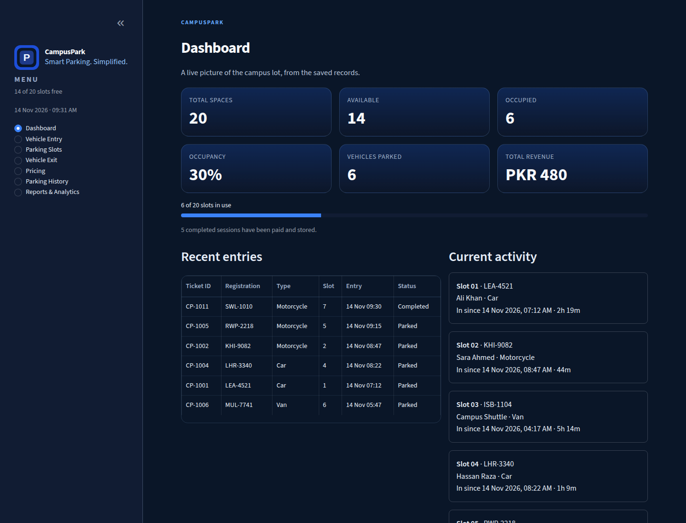
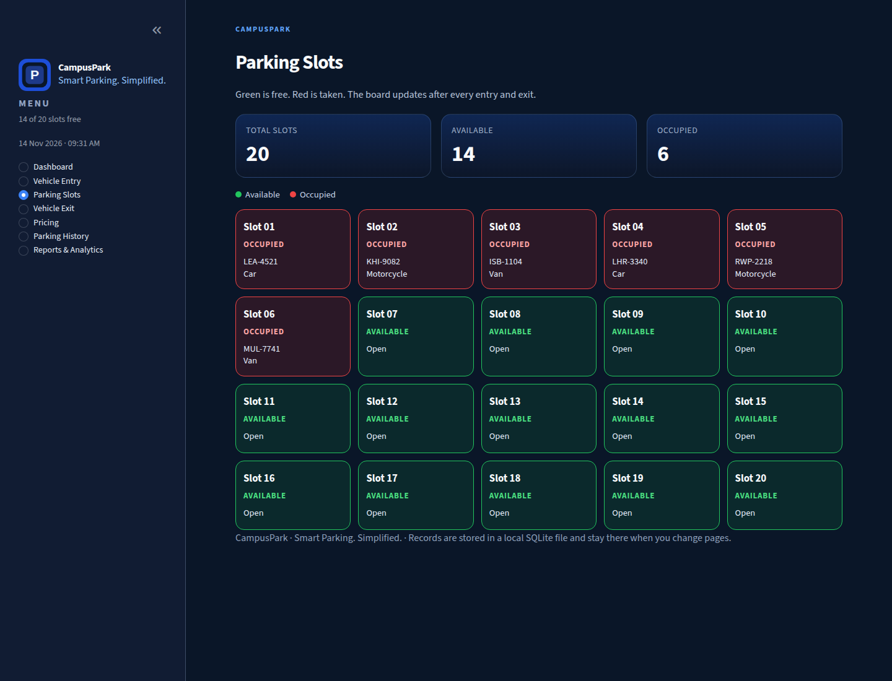
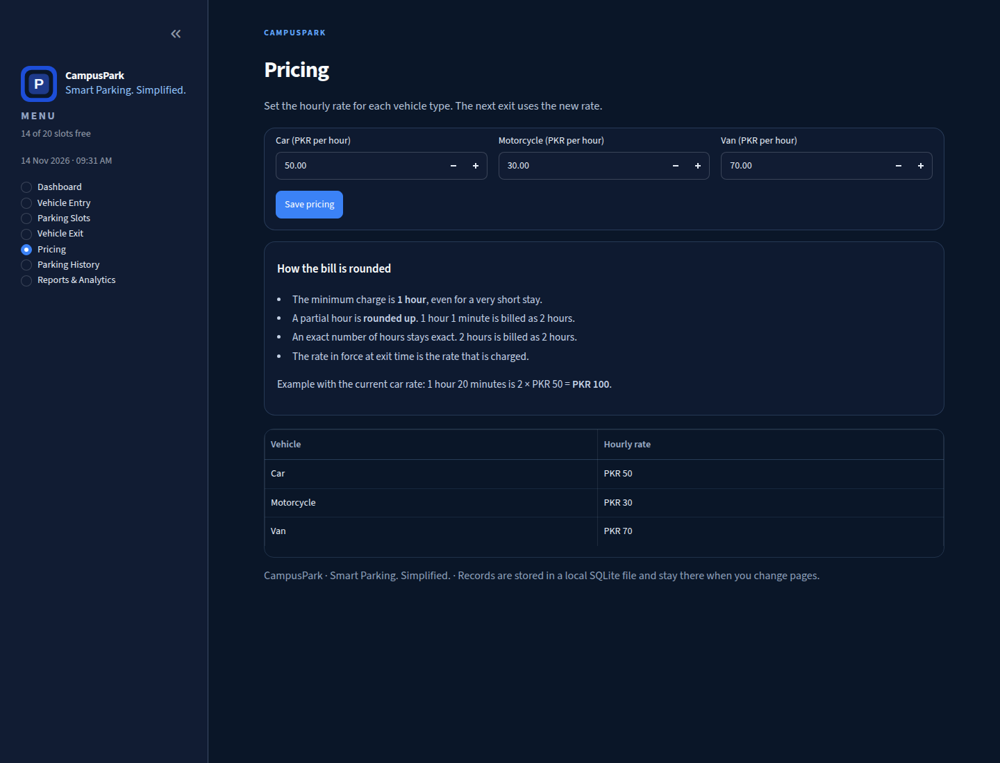
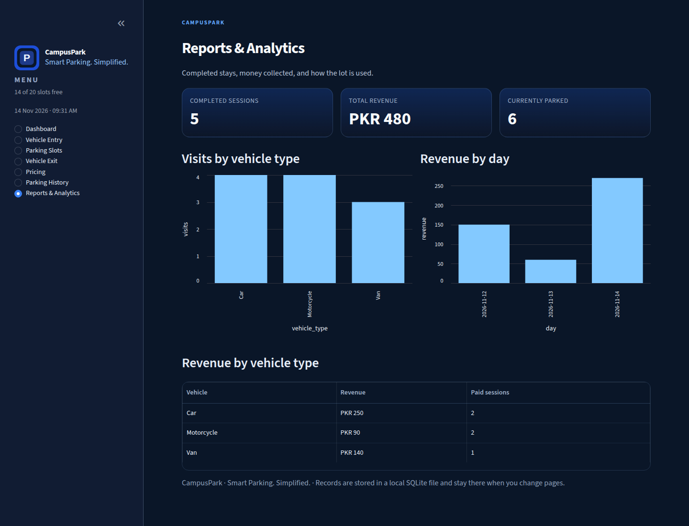

# CampusPark

**Smart Parking. Simplified.**

CampusPark is a small parking desk for a university campus. An attendant can check a vehicle in, see which of the 20 slots are free, charge a fee when the vehicle leaves, and look back at past visits. The program is a semester project for an OOP lab. It is written so two beginners can read it, run it, and explain it.

The rules live in Python classes. The screen is Streamlit. The records sit in a SQLite file, so they are still there after you change page, refresh the browser, or stop and start the app on your own computer.



## Objectives

- Give the attendant one screen for entry, slots, exit, prices, history, and reports.
- Model the problem with classes: a vehicle, a slot, a ticket, a fee calculator, a database helper, and a manager that uses the others.
- Store every visit so a refresh does not wipe the lot.
- Charge a clear, configurable hourly fee in Pakistani Rupees.
- Keep the code short enough to revise for a viva.

## Features

| Page | What it does |
| --- | --- |
| Dashboard | Total spaces, free slots, occupied slots, occupancy, vehicles inside, revenue, recent entries, and who is parked now. All of these numbers are read from the database. |
| Vehicle Entry | Registration, owner, type (Car, Motorcycle, or Van), and entry time. The first free slot is assigned. A ticket id such as `CP-1001` is saved. |
| Parking Slots | All 20 slots. Green means available. Red means occupied, and the card shows the registration and type. |
| Vehicle Exit | Search by registration or ticket id. Shows entry, exit, duration, billable hours, rate, and total, then frees the slot. |
| Pricing | Default rates are Car PKR 50, Motorcycle PKR 30, and Van PKR 70 per hour. An admin can change them. The next exit uses the saved rate. |
| Parking History | Every visit, with search and filters for status and vehicle type, plus a CSV download. |
| Reports & Analytics | Completed sessions, revenue, vehicles still inside, visits by type, and revenue by day. |

There is no login. The project does not need one.

## Fee rule

Time is measured from entry to exit.

- The smallest bill is **1 hour**, even if the vehicle leaves immediately.
- Any part of an extra hour is **rounded up**. 1 hour 20 minutes is billed as 2 hours.
- An exact number of hours stays exact. 2 hours is billed as 2 hours, not 3.
- The rate saved on the Pricing page at exit time is the rate that is charged.

Worked example at the default car rate: 1 hour 20 minutes is `2 × PKR 50 = PKR 100`.

## Tech stack

- Python 3.12
- Streamlit 1.67 (the pages)
- SQLite through the standard `sqlite3` module (no separate database server)
- Pandas, used to shape the tables and charts
- pytest, for the automated tests

Versions that were installed and tested are pinned in `requirements.txt`.

## OOP concepts in this project

The ideas below are the ones a teacher will ask about. Each one points at a real class.

| Idea | Where to show it |
| --- | --- |
| Class and object | `Vehicle` in `models/vehicle.py`. `Car("LEA-4521", "Ali Khan")` is one object. |
| Constructor | `Vehicle.__init__` stores the registration and the owner. Subclasses call it with `super().__init__`. |
| Encapsulation | Attributes such as `_registration_number` are meant to be read through `@property`. There is no setter, so `car.registration_number = "OTHER"` raises `AttributeError`. |
| Inheritance | `Car`, `Motorcycle`, and `Van` inherit from `Vehicle`. |
| Method overriding | Each subclass writes its own `get_vehicle_type`, `get_hourly_rate`, and `get_description`. |
| Polymorphism | `Vehicle.create("van", ...)` returns a `Van`, but the rest of the code can call `get_description()` without asking which subclass it is. `PaymentCalculator.rate_for` does the same with `get_vehicle_type()` and `get_hourly_rate()`. |
| Composition | `ParkingManager` **has** a `DatabaseManager` and a `PaymentCalculator`. It does not inherit from them. See `services/parking_manager.py`. |
| Exception handling | `utils/exceptions.py`. The pages catch `ParkingError` and show the message. They do not show a SQL error to the attendant. |

`DatabaseManager` (`database/database_manager.py`) is the only class that runs SQL. Queries use `?` placeholders.

## How a visit moves through the objects

1. The entry form calls `ParkingManager.register_vehicle`.
2. The manager cleans the registration and the owner name (`utils/helpers.py`).
3. `Vehicle.create` builds a `Car`, `Motorcycle`, or `Van`.
4. `DatabaseManager.create_entry` saves the vehicle, picks the lowest free slot, and inserts a ticket. `ParkingSlot.occupy` refuses a slot that is already taken. The whole save is one database transaction.
5. On exit, `PaymentCalculator.calculate` builds the bill. The manager then asks the database to close the ticket, insert a row in `transactions`, and `release` the slot.
6. The dashboard reads the same file, so the cards change as soon as the save finishes.

## Database

The file is `data/campuspark.db`. It is created the first time the app runs. The folder is created if it is missing. Tables are created with `CREATE TABLE IF NOT EXISTS`, then 20 slots and the three default prices are inserted only when those tables are empty. Restarting the app does not wipe rows that are already there.

| Table | What it stores |
| --- | --- |
| `vehicles` | One row per entry: registration, owner, type, time. |
| `parking_slots` | Slots 1 to 20, each available or occupied. |
| `parking_tickets` | Every visit. `parked` while the vehicle is inside, `completed` after exit. |
| `transactions` | The payment for a completed visit: times, billable hours, rate, fee. |
| `pricing` | The hourly rate for each vehicle type. |

A partial unique index on `parking_tickets` allows only one **parked** row for a registration. The same car can enter again after it has left.

The database file is listed in `.gitignore`. Do not commit it. A fresh clone starts with an empty lot. The screenshots below were taken from a local sample session so the pages are not blank.

Set `CAMPUSPARK_DB` if you want the file somewhere else:

```bash
export CAMPUSPARK_DB="$HOME/campuspark.db"
streamlit run app.py
```

## Install and run

From the project folder:

```bash
python3 -m venv .venv
source .venv/bin/activate
pip install -r requirements.txt
streamlit run app.py
```

Open the local URL Streamlit prints (normally http://localhost:8501).

On Windows, activate the virtual environment with `.venv\Scripts\activate`.

### A short demo for the viva

1. Open **Vehicle Entry**. Use a registration such as `LEA-4521`, an owner name, and type Car. Set the entry time about two hours earlier than now if you want a multi-hour bill.
2. The success message names the ticket and the slot. **Parking Slots** shows that slot in red.
3. Open **Vehicle Exit**, search the registration, and read the breakdown. Completing the exit turns the slot green.
4. **Parking History**, **Dashboard**, and **Reports & Analytics** all show the saved visit.
5. Try to enter the same registration while it is still inside. The app refuses. Try a 21st vehicle when all 20 slots are red. The app says the lot is full.

## Tests

```bash
python3 -m pytest tests -v
```

The last run in this workspace was:

```text
============================= test session starts ==============================
platform linux -- Python 3.12.3, pytest-9.2.0, pluggy-1.7.0 -- /usr/bin/python3
collected 28 items

tests/test_app_smoke.py::test_every_page_renders PASSED
tests/test_app_smoke.py::test_entry_page_parks_a_vehicle PASSED
tests/test_payment_and_models.py::test_partial_hour_rounds_up_and_exact_hour_does_not PASSED
tests/test_payment_and_models.py::test_exit_before_entry_is_rejected PASSED
tests/test_payment_and_models.py::test_admin_rate_overrides_the_class_default PASSED
tests/test_payment_and_models.py::test_missing_rate_falls_back_to_the_subclass PASSED
tests/test_payment_and_models.py::test_subclasses_override_type_rate_and_description PASSED
tests/test_payment_and_models.py::test_unknown_vehicle_type_is_rejected PASSED
tests/test_payment_and_models.py::test_properties_do_not_allow_direct_assignment PASSED
tests/test_payment_and_models.py::test_slot_cannot_be_occupied_twice PASSED
tests/test_payment_and_models.py::test_closed_ticket_cannot_be_closed_again PASSED
tests/test_payment_and_models.py::test_empty_and_invalid_fields_are_rejected PASSED
tests/test_payment_and_models.py::test_cannot_exit_a_vehicle_that_is_not_parked PASSED
tests/test_payment_and_models.py::test_history_search_and_filters PASSED
tests/test_payment_and_models.py::test_rate_change_is_used_on_the_next_exit PASSED
tests/test_payment_and_models.py::test_zero_rate_is_rejected PASSED
tests/test_spec_cases.py::test_01_register_new_vehicle PASSED
tests/test_spec_cases.py::test_02_auto_allocate_first_free_slot PASSED
tests/test_spec_cases.py::test_03_register_another_vehicle PASSED
tests/test_spec_cases.py::test_04_occupied_slots_update PASSED
tests/test_spec_cases.py::test_05_duplicate_parked_vehicle_rejected PASSED
tests/test_spec_cases.py::test_06_parking_full_rejected PASSED
tests/test_spec_cases.py::test_07_exit_vehicle PASSED
tests/test_spec_cases.py::test_08_fee_minimum_one_hour_and_round_up PASSED
tests/test_spec_cases.py::test_09_released_slot_becomes_available PASSED
tests/test_spec_cases.py::test_10_history_saved_after_exit PASSED
tests/test_spec_cases.py::test_11_dashboard_stats_update PASSED
tests/test_spec_cases.py::test_12_data_persists_after_new_database_manager PASSED

============================== 28 passed in 0.91s ==============================
```

`tests/test_spec_cases.py` is the 12-case list from the brief. The other files cover the fee rule, validation, and a headless Streamlit pass over every page. While the app was running, `curl http://127.0.0.1:8501/_stcore/health` returned `ok`.

## Screenshots

These pictures are from one local session. They are not the empty database you get on a fresh clone.










## Project layout

```text
app.py                          Streamlit pages
requirements.txt
runtime.txt                     Python 3.12 for Streamlit Community Cloud
.streamlit/config.toml          Dark navy theme
assets/logo.svg
assets/style.css
database/database_manager.py    All SQL
models/vehicle.py               Vehicle, Car, Motorcycle, Van
models/parking_slot.py
models/parking_ticket.py
services/parking_manager.py
services/payment_calculator.py
utils/helpers.py
utils/exceptions.py
tests/
docs/
```

## Team contribution

The brief splits the work like this. Both students must be able to explain the whole app, not only their own files.

- **Student 1** — vehicle and parking models, allocation logic, fee calculation, and main app integration. That is `models/`, `services/payment_calculator.py`, and the `ParkingManager` methods that create a vehicle, ask for a slot, and close a ticket. `app.py` calls those methods.
- **Student 2** — database management, dashboard and UI, entry and exit forms, testing, and documentation. That is `database/database_manager.py`, the Streamlit pages in `app.py`, `tests/`, and `docs/`.

The first free slot is chosen inside `DatabaseManager.create_entry` so the check and the save cannot drift apart. `ParkingManager.register_vehicle` is the method the screen calls. Either student should be able to walk through both.

## Deploy on Streamlit Community Cloud

The entry point is `app.py`.

1. Push this repository to GitHub. The repo can be public. Community Cloud deploys from GitHub.
2. Open [https://share.streamlit.io/](https://share.streamlit.io/) and sign in with GitHub.
3. Choose **Create app**.
4. Select this repository, the branch you want (usually `main`), and set **Main file path** to `app.py`.
5. Deploy. Streamlit installs `requirements.txt`. `runtime.txt` asks for Python 3.12.
6. When the app is up, check entry, the slot board, and exit once.

No API keys are required. Do not add a `secrets.toml` with passwords.

### SQLite on Streamlit Cloud does not last forever

This is a real limit, not a bug in the classes.

Streamlit Community Cloud runs the app on a container whose disk is **ephemeral**. `data/campuspark.db` is created when the app starts, and it survives ordinary page changes and refreshes **while that container stays up**. A reboot, a new deploy, or the app going to sleep can delete the file. The next visitor then sees an empty lot.

For the lab demo, run CampusPark on a laptop. That file survives restarts. If you only need to move the file, set `CAMPUSPARK_DB` to a path you control.

A hosted database (for example a small hosted SQL service) would survive deploys, but that would replace `DatabaseManager`'s SQLite connection. It is left out on purpose so the project stays on one file and the standard library. The class is the only place that would need to change.

## More write-ups

- [Viva guide](docs/VIVA_GUIDE.md) — how the system works, plus 24 likely questions and answers.
- [Project report](docs/PROJECT_REPORT.md) — design, schema, class diagram, and the real test results.
- [Presentation](docs/PRESENTATION.md) — 12 slides.
