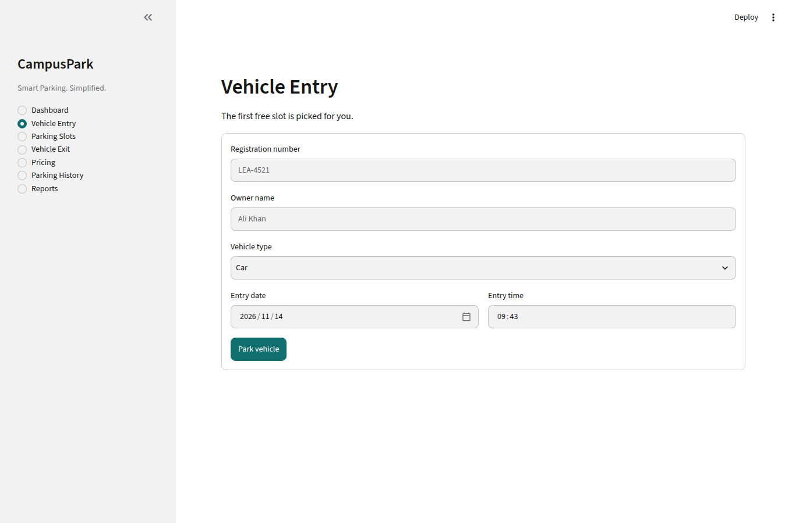
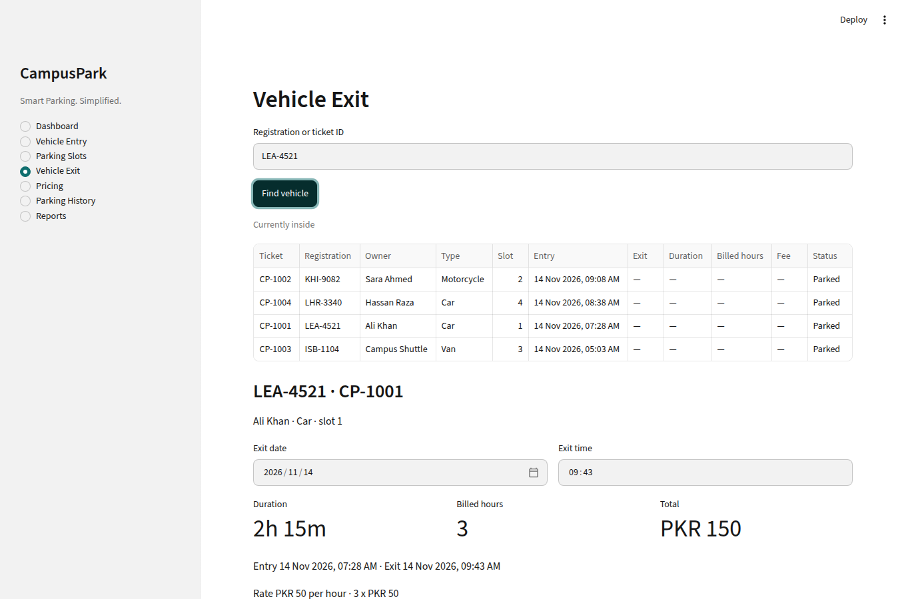
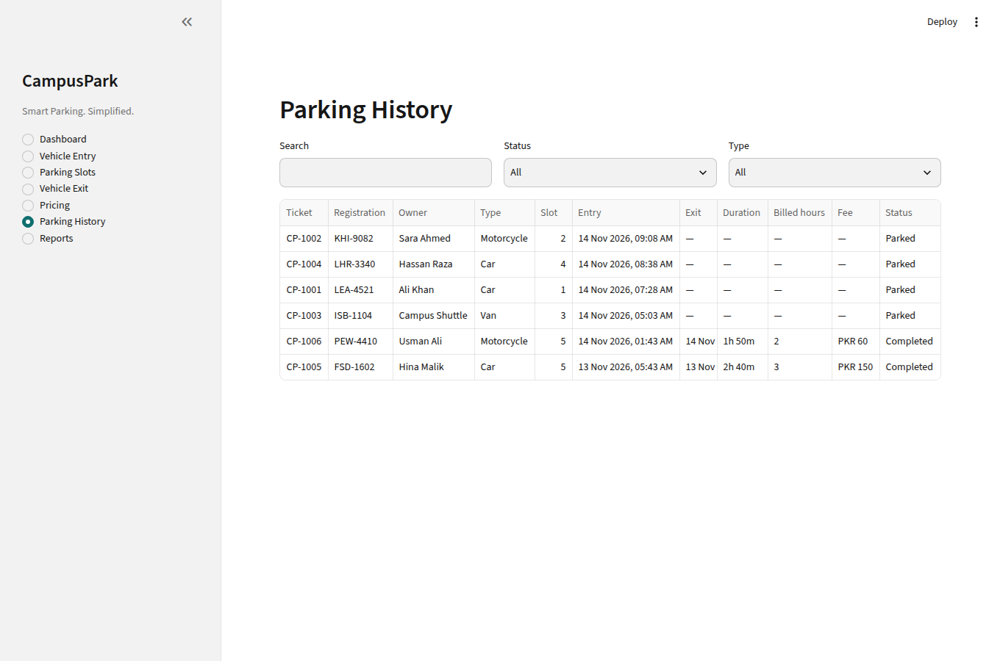

# CampusPark

Smart Parking. Simplified.

This is our 3rd semester OOP project. It is a small parking system for a campus lot with 20 slots. The attendant can park a vehicle, see which slots are free, charge a fee when it leaves, and look back at old visits.

The screen is Streamlit. The data is a SQLite file called `data/campuspark.db`. On your own computer that file stays after you refresh the page or restart the app.

## How to run

```bash
python3 -m venv .venv
source .venv/bin/activate
pip install -r requirements.txt
streamlit run app.py
```

Tests:

```bash
python3 -m pytest tests -v
```

The last run on this machine was 14 passed in 0.82 seconds. The full list is in `docs/PROJECT_REPORT.md`.

## Pages

- **Dashboard** — slot counts, occupancy, revenue, recent visits, who is parked now.
- **Vehicle Entry** — registration, owner, type (Car, Motorcycle, Van), and entry time. The first free slot is assigned and a ticket id like `CP-1001` is saved.
- **Parking Slots** — all 20 slots. Green means free, red means taken.
- **Vehicle Exit** — search by registration or ticket id, see the bill, then free the slot.
- **Pricing** — default rates are Car 50, Motorcycle 30, Van 70 PKR per hour. You can change them.
- **Parking History** — search and filter old visits.
- **Reports** — completed visits, revenue, and two simple charts.

## Fee rule

- The smallest bill is 1 hour, even for a short stay.
- If the stay goes past a full hour, that extra part is rounded up. 1 hour 20 minutes is billed as 2 hours.
- An exact number of hours stays exact. 2 hours is billed as 2 hours.
- The rate on the Pricing page is the one used at exit time.

Example: a car for 1 hour 20 minutes is `2 x PKR 50 = PKR 100`.

## Where the OOP is

| Class | File | What it does |
| --- | --- | --- |
| `Vehicle`, `Car`, `Motorcycle`, `Van` | `models/vehicle.py` | Parent class and three child classes. Each child overrides `get_type` and `get_hourly_rate`. |
| `ParkingSlot` | `models/parking_slot.py` | One slot. `occupy` and `release`. |
| `ParkingTicket` | `models/parking_ticket.py` | One visit. `close` when the vehicle leaves. |
| `PaymentCalculator` | `services/payment_calculator.py` | Works out the hours and the fee. |
| `DatabaseManager` | `database/database_manager.py` | All the SQL. Queries use `?` placeholders. |
| `ParkingManager` | `services/parking_manager.py` | The object the pages call. It keeps a `DatabaseManager` and a `PaymentCalculator`. |

Private attributes start with `_` and are read through properties. Errors are a single `ParkingError` in `utils/exceptions.py`. The pages catch it and show the message.

## Database

Tables: `vehicles`, `parking_slots`, `parking_tickets`, `transactions`, `pricing`.

A ticket is the visit. A transaction is the payment, written only when the vehicle exits. The same registration cannot have two parked tickets at once. After exit it can come back.

The `.db` file is in `.gitignore`, so a fresh clone starts empty. The screenshots below are from a sample we entered locally.

On Streamlit Community Cloud the disk can be wiped when the app is redeployed or the server restarts. Page changes are fine while it is running. For the viva, run it on a laptop if you need the data to stay.

## Deploy

1. Push the repo to GitHub.
2. Open [https://share.streamlit.io/](https://share.streamlit.io/) and sign in with GitHub.
3. Create an app, pick this repo, and set the main file to `app.py`.
4. Deploy. `requirements.txt` and `runtime.txt` (Python 3.12) are already there.

No API keys are needed.

## Screenshots











## Team

Both of us should be able to explain the whole program.

- **Student 1** — vehicle and parking models, how a slot is chosen, the fee calculation, and connecting that to the app (`models/`, `services/payment_calculator.py`, `ParkingManager`).
- **Student 2** — the database class, the Streamlit pages, the entry and exit forms, the tests, and these docs.

The SQL that picks the first free slot is in `DatabaseManager`, because that is the only class that runs SQL. The button calls `ParkingManager.register_vehicle`.

Other write-ups: [viva guide](docs/VIVA_GUIDE.md), [project report](docs/PROJECT_REPORT.md), [presentation](docs/PRESENTATION.md).
