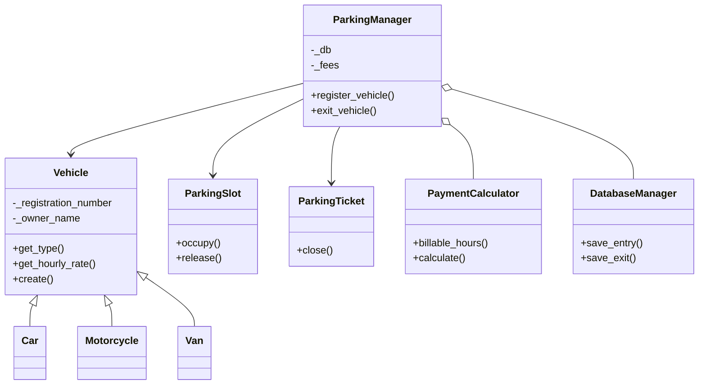

# CampusPark project report

OOP lab, 3rd semester. A parking screen for a campus lot of 20 slots.

## Abstract

CampusPark lets an attendant park a car, motorcycle, or van, see the slots, and charge a fee on exit. The rules are Python classes. The screen is Streamlit. The records are in SQLite. Cars start at PKR 50 per hour, motorcycles at PKR 30, and vans at PKR 70. The minimum bill is one hour, and a partial hour is rounded up. We ran `python3 -m pytest tests -v` and got 14 passed, 0 failed.

## 1. Introduction

The gate needs to know which slots are free, which vehicle is in which slot, and what to charge on the way out. A list in memory disappears when the program stops. We keep the rows in `data/campuspark.db`.

## 2. What it does

- Park a vehicle and give it the first free slot and a ticket id (`CP-1001`, then `CP-1002`, and so on).
- Refuse a second entry if that registration is already inside.
- Refuse entry when all 20 slots are taken.
- Show the lot. Free slots are green, taken slots are red.
- On exit, show duration, billed hours, rate, and total, then free the slot.
- Let us edit the three hourly rates.
- Search history and show a couple of charts.

There is no login. We do not need one for this lab.

## 3. Design

The pages in `app.py` do not write SQL and do not multiply the fee. They call `ParkingManager`.

```text
app.py
  ParkingManager
      DatabaseManager  ->  campuspark.db
      PaymentCalculator
      Vehicle / Car / Motorcycle / Van
      ParkingSlot
      ParkingTicket
```

An entry is one database transaction. If the slot update fails, the ticket is not left half-saved. An exit is one transaction too.

## 4. Class diagram



`Car`, `Motorcycle`, and `Van` do not add new attributes. They only override `get_type` and `get_hourly_rate`.

## 5. Database

| Table | Rows |
| --- | --- |
| `vehicles` | One per arrival: registration, owner, type, time |
| `parking_slots` | Slots 1 to 20, available or occupied |
| `parking_tickets` | One per visit. Status is `parked` or `completed` |
| `transactions` | One payment per completed visit: hours, rate, fee |
| `pricing` | Car, Motorcycle, Van and the hourly rate |

Times are stored as text, `YYYY-MM-DD HH:MM:SS`, so they sort easily.

A unique index on `parking_tickets(registration_number)` where `status = 'parked'` blocks two active visits for the same plate.

User values go in as `?` parameters, not inside the SQL string.

## 6. Fee

| Stay | Hours billed |
| --- | --- |
| Up to 60 minutes | 1 |
| Exactly 1 hour | 1 |
| 1 hour 1 minute | 2 |
| Exactly 3 hours | 3 |

Test 08 checks a real exit, not only the calculator: a car for 1 hour 20 minutes is PKR 100, a motorcycle for 20 minutes is PKR 30, and a van for exactly 3 hours is PKR 210.

## 7. Testing

Command:

```bash
python3 -m pytest tests -v --tb=line
```

Output from the run on Python 3.12.3:

```text
============================= test session starts ==============================
platform linux -- Python 3.12.3, pytest-9.2.0, pluggy-1.7.0 -- /usr/bin/python3
collected 14 items

tests/test_app.py::test_every_page_opens PASSED                          [  7%]
tests/test_app.py::test_entry_form_parks_a_vehicle PASSED                [ 14%]
tests/test_parking.py::test_01_register_new_vehicle PASSED               [ 21%]
tests/test_parking.py::test_02_auto_allocate_first_free_slot PASSED      [ 28%]
tests/test_parking.py::test_03_register_another_vehicle PASSED           [ 35%]
tests/test_parking.py::test_04_occupied_slots_update PASSED              [ 42%]
tests/test_parking.py::test_05_duplicate_parked_vehicle_rejected PASSED  [ 50%]
tests/test_parking.py::test_06_parking_full_rejected PASSED              [ 57%]
tests/test_parking.py::test_07_exit_vehicle PASSED                       [ 64%]
tests/test_parking.py::test_08_fee_minimum_one_hour_and_round_up PASSED  [ 71%]
tests/test_parking.py::test_09_released_slot_becomes_available PASSED    [ 78%]
tests/test_parking.py::test_10_history_saved_after_exit PASSED           [ 85%]
tests/test_parking.py::test_11_dashboard_stats_update PASSED             [ 92%]
tests/test_parking.py::test_12_data_persists_after_new_database_manager PASSED [100%]

============================== 14 passed in 0.82s ==============================
```

| Test | What we checked | Result |
| --- | --- | --- |
| 01 | New vehicle, cleaned registration, ticket `CP-1001` | Passed |
| 02 | First vehicle gets slot 1 | Passed |
| 03 | Second vehicle gets slot 2 and the next ticket id | Passed |
| 04 | Occupied count becomes 2, slot 3 stays free | Passed |
| 05 | Same plate, different spelling, is rejected | Passed |
| 06 | 21st vehicle is rejected when the lot is full | Passed |
| 07 | Exit marks the ticket completed and clears the active list | Passed |
| 08 | Minimum 1 hour and rounding up, for car, motorcycle, and van | Passed |
| 09 | Freed slot is available, and the same car can take it again | Passed |
| 10 | History and the `transactions` row keep the fee | Passed |
| 11 | Dashboard revenue and occupancy change after one exit | Passed |
| 12 | A new `DatabaseManager` on the same file still sees the car and the edited rate | Passed |

`test_every_page_opens` runs the Streamlit app headlessly and opens each page. `test_entry_form_parks_a_vehicle` submits the entry form and checks that ticket `CP-1001` appears.

We also started the app and opened it in a browser to take the screenshots in `docs/screenshots/`. Those pictures use a few sample rows. The database file is not committed.

## 8. Streamlit Cloud

`app.py` is the entry file. `requirements.txt` pins Streamlit, pandas, and pytest to the versions we ran.

The SQLite file survives normal clicks. On Streamlit Community Cloud a redeploy can delete it, because that disk is temporary. For marking, run the app locally.

## 9. Conclusion

The attendant can enter a vehicle, see the lot, charge a rounded fee, and find the visit later. The classes match the things in the problem. The tests above are the ones we actually ran.

## 10. Team

- **Student 1** — models, allocation, fees, and app integration.
- **Student 2** — database, UI pages, entry and exit forms, testing, and documentation.

Both of us are supposed to understand the whole app, not only our own files.
