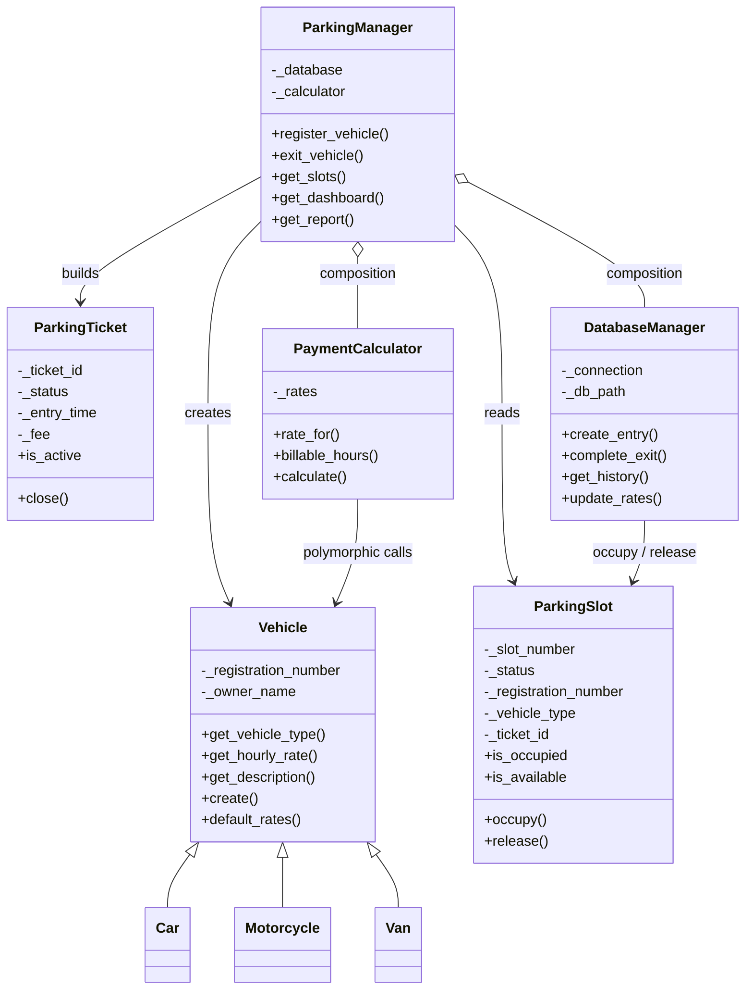
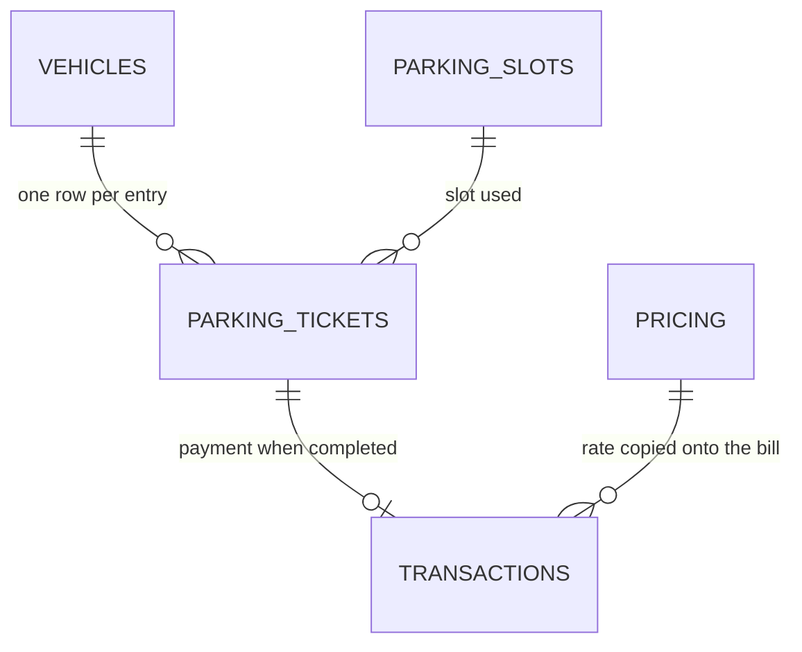

# CampusPark — Project Report

**Smart Parking. Simplified.**

University OOP lab project. A desktop-style web app for a campus parking attendant.

## Abstract

CampusPark records vehicles entering and leaving a campus lot of 20 slots. The attendant uses a Streamlit application. Parking rules and fees are Python objects. SQLite stores slots, tickets, and payments so the data is still there after a refresh or a restart on a local machine. Cars are charged PKR 50 per hour, motorcycles PKR 30, and vans PKR 70, unless an admin changes the rate. The minimum bill is one hour, and a partial hour is rounded up. Automated tests cover registration, slot allocation, duplicates, a full lot, exit, fees, history, dashboard totals, and a restarted database connection. All 28 tests passed.

## 1. Introduction

A campus gate needs three answers at any moment: is there a free slot, which vehicle is in which slot, and what should this vehicle pay. A spreadsheet is easy to overwrite. A single script with global lists dies when the program stops.

CampusPark keeps those answers in a small database and shows them on a dark, single-window desk screen. The programming aim is the object model, not a large website. Two beginners should be able to open one class and say what it is responsible for.

## 2. Objectives

- Check a vehicle in and give it the first free slot and a unique ticket id.
- Refuse a second entry for a vehicle that is already inside.
- Refuse entry when all 20 slots are occupied.
- Show the lot as a board: green available, red occupied.
- On exit, compute duration and fee, save the payment, and free the slot.
- Let an admin edit the three hourly rates.
- Show history with search and filters, and show simple charts.
- Keep records across page changes, refreshes, and a new process on the same database file.

## 3. Scope

Included:

- One attendant screen. No accounts and no passwords.
- Three vehicle types: Car, Motorcycle, Van.
- A fixed lot of 20 slots, created automatically.
- Fees in PKR, minimum one hour, partial hours rounded up.
- Local SQLite storage.

Not included:

- Online payment, barriers, cameras, or number-plate recognition.
- More than one lot.
- A hosted database. Section 9 explains why the SQLite file on Streamlit Community Cloud can disappear after a redeploy.

## 4. System design

The screen never writes SQL and never multiplies the fee. It calls `ParkingManager`.

```text
app.py
  ParkingManager
      DatabaseManager     ->  campuspark.db
      PaymentCalculator
      Vehicle / Car / Motorcycle / Van
      ParkingSlot
      ParkingTicket
```

`ParkingManager` is composed of the database helper and the calculator. It creates vehicle, slot, and ticket objects. `DatabaseManager` also uses `ParkingSlot.occupy` and `ParkingSlot.release` so the "already taken" rule sits in the slot class even though the row is saved with SQL.

An entry is one transaction: if the slot update fails, the ticket insert is rolled back. An exit is one transaction as well: close the ticket, insert the payment, free the slot.

## 5. Class diagram



`Car`, `Motorcycle`, and `Van` do not add new attributes. They override three methods. That is enough for this problem. Extra abstract layers would make the viva harder without changing the behaviour.

## 6. Database schema

The file is `data/campuspark.db`. Tables are created if they are missing. Slots and default prices are inserted only when those tables are empty.



### vehicles

| Column | Type | Notes |
| --- | --- | --- |
| id | INTEGER PK | Autoincrement |
| registration_number | TEXT | Not unique. The same car may visit again later. |
| owner_name | TEXT | |
| vehicle_type | TEXT | Car, Motorcycle, or Van |
| created_at | TEXT | Entry time, `YYYY-MM-DD HH:MM:SS` |

### parking_slots

| Column | Type | Notes |
| --- | --- | --- |
| slot_number | INTEGER PK | 1 to 20 |
| status | TEXT | `available` or `occupied` |
| registration_number | TEXT | Null when free |
| vehicle_type | TEXT | Null when free |
| ticket_id | TEXT | Null when free |

### parking_tickets

| Column | Type | Notes |
| --- | --- | --- |
| ticket_id | TEXT PK | `CP-1001`, `CP-1002`, ... |
| vehicle_id | INTEGER | Foreign key to vehicles |
| registration_number | TEXT | |
| owner_name | TEXT | |
| vehicle_type | TEXT | |
| slot_number | INTEGER | Foreign key to parking_slots |
| entry_time | TEXT | |
| status | TEXT | `parked` or `completed` |

Unique index `idx_one_active_registration` on `registration_number` where `status = 'parked'`.

### transactions

| Column | Type | Notes |
| --- | --- | --- |
| id | INTEGER PK | |
| ticket_id | TEXT UNIQUE | One payment per ticket |
| registration_number, owner_name, vehicle_type, slot_number | | Copied so the receipt does not depend on a later edit |
| entry_time, exit_time | TEXT | |
| duration_text | TEXT | For example `1h 20m` |
| billable_hours | INTEGER | After rounding |
| hourly_rate | REAL | Rate used for this bill |
| fee | REAL | hours × rate |
| status | TEXT | `completed` |

### pricing

| Column | Type | Notes |
| --- | --- | --- |
| vehicle_type | TEXT PK | |
| hourly_rate | REAL | Must be greater than 0 |

Seeded values: Car 50, Motorcycle 30, Van 70.

Every statement that includes a form value uses a `?` placeholder. String formatting is not used to build SQL.

## 7. Modules

### Dashboard

Reads `ParkingManager.get_dashboard()`. Shows six figures, an occupancy bar, the latest visits, and a card for each vehicle still inside. Revenue is the sum of saved fees, not an estimate of cars still parked.

### Vehicle entry

Form fields: registration, owner, type, entry date, entry time. On success the page shows the ticket id, slot, and the vehicle's own description (`get_description()`). Errors such as a duplicate or a full lot stay on the form as a red message.

### Parking slots

Twenty cards. Available cards are green. Occupied cards are red and show the registration and type. The board is redrawn from the database on each run, so it matches the last entry or exit.

### Vehicle exit

Search by registration or ticket id (`CP-...`). The page lists who is inside, then shows entry, exit, duration, billable hours, hourly rate, and total. Confirming writes the transaction and releases the slot.

### Pricing

Three number inputs and a short explanation of rounding, including a worked example that uses the current car rate. Saving updates `pricing`. The following exit uses the new numbers. A zero rate is rejected.

### History

Columns: ticket id, registration, owner, type, slot, entry, exit, duration, billable hours, fee, status. Search matches ticket, registration, or owner, ignoring case. Filters: All / Parked / Completed, and vehicle type. The visible rows can be downloaded as CSV.

### Reports

Completed session count, total revenue, vehicles currently parked, a bar chart of visits by type, a bar chart of revenue by day, and a table of revenue by type. Days come from the exit timestamp.

## 8. Fee policy

| Stay | Billable hours |
| --- | --- |
| 0 minutes up to 60 minutes | 1 |
| Exactly 1 hour | 1 |
| 1 hour 1 minute | 2 |
| Exactly 2 hours | 2 |
| Exactly 3 hours | 3 |

At the default rates, a 90 minute car visit is PKR 100. A 20 minute motorcycle visit is PKR 30. A 3 hour van visit is PKR 210. These three numbers are asserted by `test_08_fee_minimum_one_hour_and_round_up` after a real exit, not only inside the calculator.

## 9. Storage limits

On a laptop, `data/campuspark.db` remains after you stop Streamlit. `test_12` opens a new `DatabaseManager` on the same file and reads the parked vehicle back.

Streamlit Community Cloud uses an ephemeral disk. The file survives ordinary clicks and refreshes on a running container. A redeploy, a reboot, or the container sleeping can delete it. The README tells the team to demonstrate on a local machine, and it names `CAMPUSPARK_DB` as the way to put the file in another folder. A hosted SQL service was not added. It would make the lab project depend on an account and a network.

## 10. Testing

Command that was run, from the project folder, on Python 3.12.3:

```bash
python3 -m pytest tests -v --tb=line
```

Result:

```text
============================= test session starts ==============================
platform linux -- Python 3.12.3, pytest-9.2.0, pluggy-1.7.0 -- /usr/bin/python3
collected 28 items

tests/test_app_smoke.py::test_every_page_renders PASSED                  [  3%]
tests/test_app_smoke.py::test_entry_page_parks_a_vehicle PASSED          [  7%]
tests/test_payment_and_models.py::test_partial_hour_rounds_up_and_exact_hour_does_not PASSED [ 10%]
tests/test_payment_and_models.py::test_exit_before_entry_is_rejected PASSED [ 14%]
tests/test_payment_and_models.py::test_admin_rate_overrides_the_class_default PASSED [ 17%]
tests/test_payment_and_models.py::test_missing_rate_falls_back_to_the_subclass PASSED [ 21%]
tests/test_payment_and_models.py::test_subclasses_override_type_rate_and_description PASSED [ 25%]
tests/test_payment_and_models.py::test_unknown_vehicle_type_is_rejected PASSED [ 28%]
tests/test_payment_and_models.py::test_properties_do_not_allow_direct_assignment PASSED [ 32%]
tests/test_payment_and_models.py::test_slot_cannot_be_occupied_twice PASSED [ 35%]
tests/test_payment_and_models.py::test_closed_ticket_cannot_be_closed_again PASSED [ 39%]
tests/test_payment_and_models.py::test_empty_and_invalid_fields_are_rejected PASSED [ 42%]
tests/test_payment_and_models.py::test_cannot_exit_a_vehicle_that_is_not_parked PASSED [ 46%]
tests/test_payment_and_models.py::test_history_search_and_filters PASSED [ 50%]
tests/test_payment_and_models.py::test_rate_change_is_used_on_the_next_exit PASSED [ 53%]
tests/test_payment_and_models.py::test_zero_rate_is_rejected PASSED      [ 57%]
tests/test_spec_cases.py::test_01_register_new_vehicle PASSED            [ 60%]
tests/test_spec_cases.py::test_02_auto_allocate_first_free_slot PASSED   [ 64%]
tests/test_spec_cases.py::test_03_register_another_vehicle PASSED        [ 67%]
tests/test_spec_cases.py::test_04_occupied_slots_update PASSED           [ 71%]
tests/test_spec_cases.py::test_05_duplicate_parked_vehicle_rejected PASSED [ 75%]
tests/test_spec_cases.py::test_06_parking_full_rejected PASSED           [ 78%]
tests/test_spec_cases.py::test_07_exit_vehicle PASSED                    [ 82%]
tests/test_spec_cases.py::test_08_fee_minimum_one_hour_and_round_up PASSED [ 85%]
tests/test_spec_cases.py::test_09_released_slot_becomes_available PASSED [ 89%]
tests/test_spec_cases.py::test_10_history_saved_after_exit PASSED        [ 92%]
tests/test_spec_cases.py::test_11_dashboard_stats_update PASSED          [ 96%]
tests/test_spec_cases.py::test_12_data_persists_after_new_database_manager PASSED [100%]

============================== 28 passed in 0.91s ==============================
```

Nothing was skipped. Nothing failed.

### The 12 cases from the brief

| # | Test | What it checked | Result |
| --- | --- | --- | --- |
| 1 | `test_01_register_new_vehicle` | `lea-4521` / `Ali Khan` / `car` is stored as `LEA-4521`, type Car, ticket `CP-1001`, status parked. The object is a `Car`. | PASSED |
| 2 | `test_02_auto_allocate_first_free_slot` | The first vehicle receives slot 1. Slots 2–20 stay available. | PASSED |
| 3 | `test_03_register_another_vehicle` | A second vehicle, a motorcycle, receives ticket `CP-1002` and slot 2. | PASSED |
| 4 | `test_04_occupied_slots_update` | Two occupied slots carry the right registration and type. Occupied count is 2 and available count is 18. | PASSED |
| 5 | `test_05_duplicate_parked_vehicle_rejected` | The same registration in another spelling raises `DuplicateVehicleError`. Still one active ticket. | PASSED |
| 6 | `test_06_parking_full_rejected` | After 20 entries, the next one raises `ParkingFullError`. Occupied is 20. | PASSED |
| 7 | `test_07_exit_vehicle` | Exit by ticket id marks the ticket completed, stores the fee, and a later search raises `VehicleNotFoundError`. | PASSED |
| 8 | `test_08_fee_minimum_one_hour_and_round_up` | Car, 1h 20m → 2 hours, PKR 100. Motorcycle, 20m → 1 hour, PKR 30. Van, exactly 3h → PKR 210. | PASSED |
| 9 | `test_09_released_slot_becomes_available` | Exiting slot 1 frees it. The same registration can enter again and is given slot 1, the lowest free slot. | PASSED |
| 10 | `test_10_history_saved_after_exit` | History has the visit, the fee, and the duration. `transactions` has its own row. | PASSED |
| 11 | `test_11_dashboard_stats_update` | After two entries and one 30-minute car exit: occupied 1, available 19, revenue PKR 50, one completed session, report totals match. | PASSED |
| 12 | `test_12_data_persists_after_new_database_manager` | A new `DatabaseManager` on the same file still sees the parked car, the occupied slot, and a rate that was changed to 80. | PASSED |

### Other automated checks

| Test | What it checked | Result |
| --- | --- | --- |
| Fee edges in `test_payment_and_models.py` | 1 minute, exact 1 hour, 1 hour 1 minute, exact 2 hours, instant exit, exit before entry | PASSED |
| Admin rate overrides the class default | `Car.get_hourly_rate()` stays 50 while the calculator charges 80 | PASSED |
| Missing saved rate | Calculator falls back to the subclass method | PASSED |
| Subclass overrides | Types, rates, and descriptions differ; `Vehicle.create("Van")` returns a `Van` | PASSED |
| Unknown type `Bus` | `ValidationError` | PASSED |
| Property assignment | `AttributeError` | PASSED |
| `ParkingSlot.occupy` twice | `ValidationError`, then `release` clears the slot | PASSED |
| Closing a ticket twice | `ValidationError` | PASSED |
| Empty and invalid fields | No slot is taken | PASSED |
| Exit of a vehicle that is not parked | `VehicleNotFoundError` | PASSED |
| History search and filters | Owner, ticket id, status, type | PASSED |
| Rate change then exit | 2 hours at PKR 40 is PKR 80 | PASSED |
| Zero rate | Rejected, car rate stays 50 | PASSED |
| `test_every_page_renders` | Streamlit `AppTest` opens all 7 pages with no exception | PASSED |
| `test_entry_page_parks_a_vehicle` | The entry form submits `LEA-4521`, shows `CP-1001`, and the slot board shows the registration | PASSED |

### Run in a browser

The app was started with `streamlit run app.py`. `curl http://127.0.0.1:8501/_stcore/health` returned `ok`.

A headless Chrome session then:

- Opened every page and saved the screenshots in `docs/screenshots/`.
- Parked motorcycle `SWL-1010` (Nadia Iqbal) into slot 7, ticket `CP-1011`.
- Saw that slot on the board.
- Tried to park `LEA-4521` again and got "already parked".
- Exited `SWL-1010` after about one minute. The receipt was 1 billable hour at PKR 30, and slot 7 was free afterwards.

The screenshots include that sample session. The database file itself is gitignored, so a classmate who clones the repo starts with an empty lot.

## 11. Conclusion

The attendant can enter a vehicle, see the lot, charge a rounded hourly fee, and look up the visit later. The object model matches the nouns in the problem: vehicle, slot, ticket, calculator, database, manager. Inheritance is used where the types differ, composition is used where one object uses another, and the database is the only place that speaks SQL. The 12 required cases, the extra rule checks, and the Streamlit page checks all passed on the run recorded above.

## 12. Future work

- A hosted database, if the app must keep data across Streamlit Cloud deploys.
- A printed or QR ticket the driver can show on exit.
- More than one lot, or a different slot count, without changing the fee class.
- An end-of-day export that accounts already support through the history CSV.

## 13. Team contribution

Both students are expected to understand the whole program.

- **Student 1** — vehicle and parking models, allocation logic, fee calculation, and main app integration (`models/`, `services/payment_calculator.py`, `ParkingManager`, and the calls from `app.py`).
- **Student 2** — database management, dashboard and UI, entry and exit forms, testing, and documentation (`database/database_manager.py`, the Streamlit pages, `tests/`, `docs/`).

The lowest free slot is selected in `DatabaseManager.create_entry` because that class owns the SQL, inside the same transaction as the insert. `ParkingManager.register_vehicle` is the operation the screen calls. The split does not mean one student can ignore the other file.
