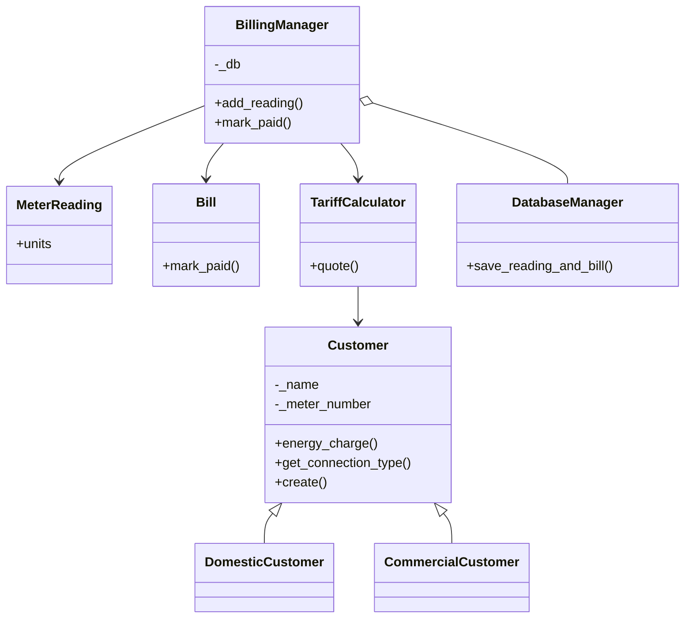

# Electricity Billing — project report

OOP lab, 3rd semester. A small office screen for electricity customers and monthly bills.

## Abstract

The program stores customers, meter readings, and bills. Domestic and commercial connections use different slab rates. Each bill also has a fixed charge and tax. After the due date, an unpaid bill gets a late surcharge. The screen is Streamlit and the file is SQLite. We ran `python3 -m pytest tests -v` and got 13 passed, 0 failed.

## 1. Introduction

An electricity counter needs the customer, the meter reading, and a bill the customer can understand. We did not keep this in a list, because a list disappears when the program stops. The rows are in `data/billing.db`.

## 2. What it covers

- Add, search, update, and delete customers (name, CNIC or ID, address, phone, meter, Domestic or Commercial).
- One reading per customer per month. Current reading must be at least the previous reading.
- A bill with slab energy, fixed charge, tax, and a late surcharge after the due date.
- View the breakdown, mark a bill paid, and list unpaid or overdue bills.
- A dashboard and a history search.
- Rates saved in the database, so they can be edited without changing the classes.

There is no login.

## 3. Design

`app.py` does not write SQL and does not do the slab maths. It calls `BillingManager`.

```text
app.py
  BillingManager
      DatabaseManager   ->  billing.db
      TariffCalculator
      Customer / DomesticCustomer / CommercialCustomer
      MeterReading
      Bill
```

The reading and the bill are inserted in one transaction. If the bill insert fails, the reading is not left behind.

## 4. Class diagram



`energy_charge` on `Customer` is not implemented. The two child classes replace it. `TariffCalculator` calls that method and then adds the fixed charge, tax, and late fee.

## 5. Database

| Table | What it stores |
| --- | --- |
| `customers` | Name, CNIC, address, phone, unique meter number, connection type |
| `meter_readings` | Month, previous, current, units. One row per customer per month |
| `bills` | Charges, due date, status (`unpaid` or `paid`), paid date |
| `tariffs` | Slab units and rates, fixed charge, tax percent |
| `settings` | `late_percent` and `due_days` |

Queries that use a name or meter number use `?` placeholders.

## 6. Default tariff

Domestic: 100 units at 10, next 100 at 20, the rest at 30. Fixed charge 100. Tax 10%.

Commercial: 100 units at 20, the rest at 40. Fixed charge 200. Tax 10%.

Late surcharge 10% after the due date. Due date is 15 days into the next month.

250 domestic units: energy 4,500 + fixed 100 + tax 460 = 5,060. If paid after the due date, add 506.

## 7. Testing

Command, from the project folder, on Python 3.12.3:

```bash
python3 -m pytest tests -v --tb=line
```

```text
============================= test session starts ==============================
platform linux -- Python 3.12.3, pytest-9.2.0, pluggy-1.7.0 -- /usr/bin/python3
collected 13 items

tests/test_app.py::test_every_page_opens PASSED                          [  7%]
tests/test_billing.py::test_add_customer PASSED                          [ 15%]
tests/test_billing.py::test_duplicate_meter_rejected PASSED              [ 23%]
tests/test_billing.py::test_reading_current_below_previous PASSED        [ 30%]
tests/test_billing.py::test_duplicate_month_rejected PASSED              [ 38%]
tests/test_billing.py::test_domestic_slab PASSED                         [ 46%]
tests/test_billing.py::test_commercial_slab PASSED                       [ 53%]
tests/test_billing.py::test_tax_and_fixed_charge PASSED                  [ 61%]
tests/test_billing.py::test_late_surcharge PASSED                        [ 69%]
tests/test_billing.py::test_mark_paid PASSED                             [ 76%]
tests/test_billing.py::test_unpaid_list PASSED                           [ 84%]
tests/test_billing.py::test_dashboard_stats PASSED                       [ 92%]
tests/test_billing.py::test_persists_after_new_database_manager PASSED   [100%]

============================== 13 passed in 0.88s ==============================
```

Nothing was skipped.

| Test | What it checked | Result |
| --- | --- | --- |
| `test_add_customer` | A domestic customer is saved and can be searched | Passed |
| `test_duplicate_meter_rejected` | The same meter, even in different case, is rejected | Passed |
| `test_reading_current_below_previous` | Current below previous saves nothing | Passed |
| `test_duplicate_month_rejected` | A second reading for the same month is rejected | Passed |
| `test_domestic_slab` | 250 domestic units give energy charge 4500 | Passed |
| `test_commercial_slab` | 250 commercial units give energy charge 8000 | Passed |
| `test_tax_and_fixed_charge` | 50 units: fixed 100, tax 60, total 660 | Passed |
| `test_late_surcharge` | Paid after 15 Feb 2026 adds 506 to a 5060 bill | Passed |
| `test_mark_paid` | Status becomes paid, and a second payment is rejected | Passed |
| `test_unpaid_list` | Unpaid list has both bills; only the old one is overdue | Passed |
| `test_dashboard_stats` | Pending and collected change after payment | Passed |
| `test_persists_after_new_database_manager` | A new `DatabaseManager` on the same file still sees the customer | Passed |
| `test_every_page_opens` | Streamlit opens all six pages | Passed |

The screenshots in `docs/screenshots/` are from a local run with a few sample customers. That database file is not in git.

## 8. Streamlit Cloud

`app.py` is still the file the existing deploy uses. `requirements.txt` pins the libraries we tested. `runtime.txt` asks for Python 3.12.

The SQLite file on Community Cloud can be removed on redeploy. The classes do not change because of that.

## 9. Conclusion

A clerk can add a customer, enter a reading, see the slab bill, and mark it paid. The two connection types share one parent class and price units in their own methods. The tests above are the run we actually did.

## 10. Team

- **Student 1** — models, tariff and billing logic, app integration.
- **Student 2** — database, pages and forms, tests, and documentation.

Both of us should understand the whole app.
